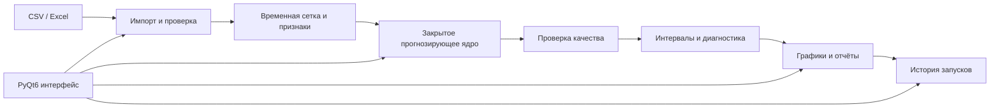

<div align="center">

# TimeRoud Forecasting

### Desktop-система для подготовки, проверки и прогнозирования временных рядов


</div>

## О проекте

TimeRoud начинался как набор экспериментов с прогнозированием, а затем вырос в desktop-приложение с единым рабочим процессом: загрузка данных, проверка временной сетки, запуск расчётов, сравнение результатов, анализ ошибок, история экспериментов и подготовка прогноза к использованию.

Это **портфельная версия** проекта. В ней показаны устройство системы и несколько безопасных примеров работы с данными. Production-код прогнозирующего ядра и внутренняя логика работы с моделями намеренно не опубликованы.

## Что реализовано в полной версии

| Направление | Возможности |
|---|---|
| Данные | Импорт таблиц, проверка типов, пропусков, дублей и временной сетки |
| Временные ряды | Работа с несколькими рядами и разными горизонтами прогноза |
| Эксперименты | Настройка запусков, журнал выполнения и история результатов |
| Проверка качества | Отложенная выборка, последовательная проверка по времени и единый набор метрик |
| Неопределённость | Интервальные оценки и контроль качества покрытия |
| Диагностика | Анализ остатков, выбросов, структурных изменений и качества данных |
| Интерфейс | Многостраничное приложение на PyQt6 с таблицами, графиками и отчётами |
| Эксплуатация | Сохранение конфигураций, воспроизводимость запусков и контроль версий данных |

## Что показывает этот репозиторий

```text
examples/
├── synthetic_series.py    # воспроизводимый искусственный временной ряд
├── data_quality.py        # проверка входной таблицы и временной сетки
├── result_contract.py     # формат результата без реализации расчётного ядра
└── run_demo.py            # небольшой демонстрационный сценарий
```

Примеры не являются копией production-модулей. Они специально сокращены и работают только с синтетическими данными.

## Архитектура полной системы



Граница `Закрытое прогнозирующее ядро` намеренно оставлена без исходного кода и деталей внутренней реализации.

## Почему проект технически интересен

- данные нельзя случайно перемешивать между прошлым и будущим;
- качество проверяется последовательно по временной оси;
- каждый запуск связан с конкретной версией данных и настройками;
- интерфейс отделён от длительных фоновых вычислений;
- ошибки импорта показываются до начала расчёта;
- результат включает не только точечные значения, но и диагностическую информацию;
- предусмотрена работа с большим количеством независимых временных рядов.

## Запуск открытого примера

```powershell
python -m venv .venv
.\.venv\Scripts\Activate.ps1
python -m pip install -r requirements.txt
python .\examples\run_demo.py
```

Пример создаст синтетический ряд, проверит его структуру и выведет отчёт о качестве данных. Реальные рабочие таблицы для этого не нужны.

## Стек полной версии

`Python` · `PyQt6` · `pandas` · `NumPy` · `SciPy` · `scikit-learn` · `statsmodels` · `Matplotlib` · `Plotly` · градиентный бустинг · статистическое прогнозирование

## Что не публикуется

- исходный код прогнозирующих моделей;
- логика выбора, согласования и совместной работы моделей;
- внутренний backtesting и расчётные эвристики;
- production-конфигурации и история запусков;
- рабочие данные, адреса, отчёты и обученные артефакты;
- полный код desktop-интерфейса и служебных модулей.

## Ограничения showcase-версии

Эта папка предназначена для знакомства с проектом и стилем инженерной работы. Она не воспроизводит полный прогнозирующий продукт и не должна восприниматься как готовая библиотека прогнозирования.

